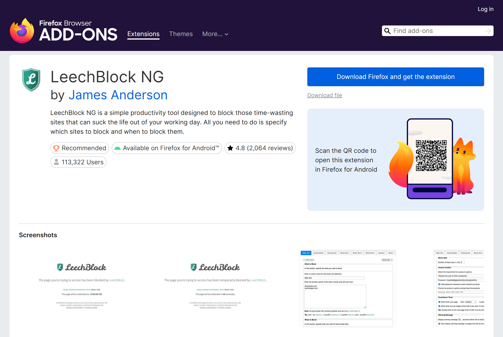
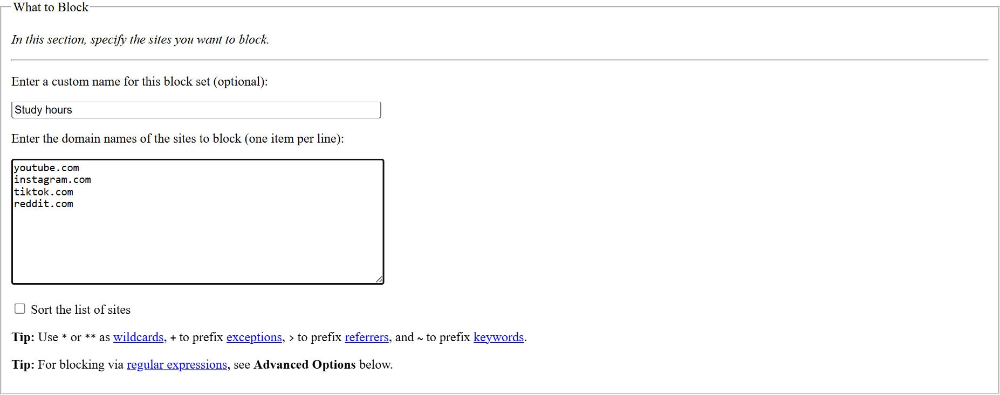
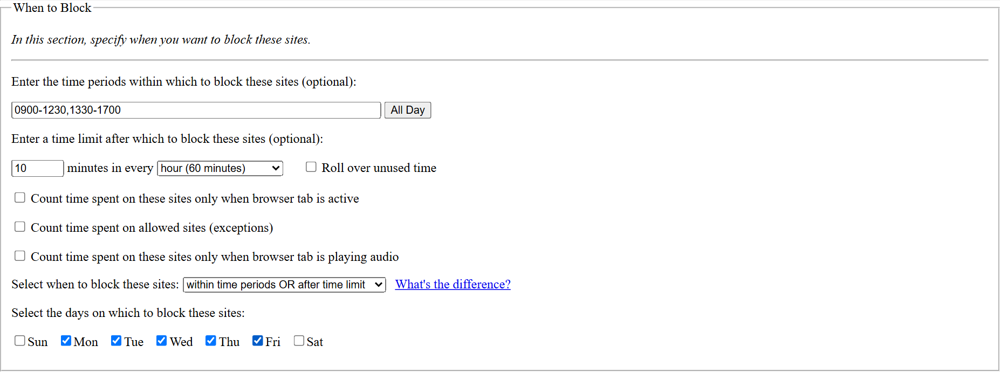
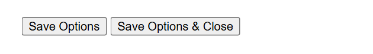
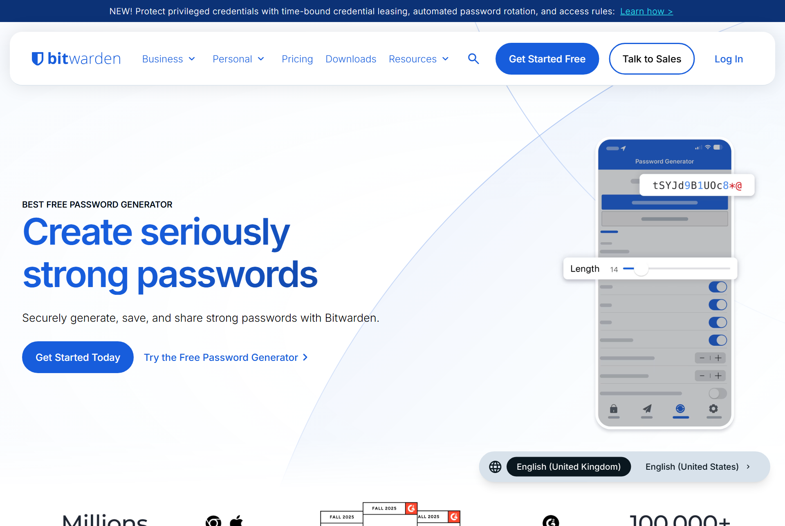
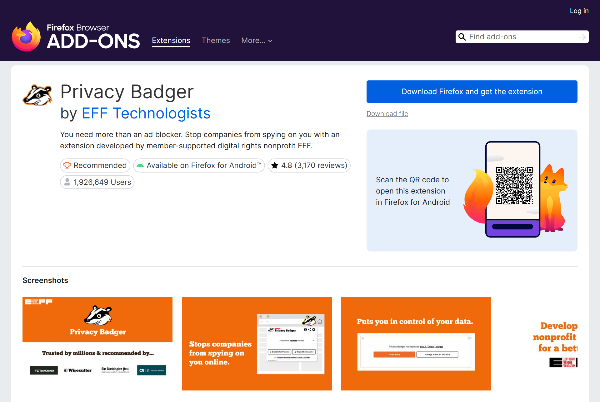

# Setup guides

Three student-written guides. Screenshots were captured in a fresh, signed-out browser with made-up example data,
so they contain no personal information. Phone pictures are labelled illustrations, not screenshots.
Images are in `public/guides/`.

## Guide 1: Block distracting websites during study hours

*Uses:* LeechBlock NG · *Time:* about 5 minutes · *Difficulty:* Easy
*You'll need:* Firefox, Chrome or Edge on Windows, Mac, Linux or Chromebook. Also Firefox for Android. On a school-managed laptop or Chromebook, installing extensions may be switched off — ask your school's IT team or use your own device.

**Why this matters.** Nearly one in three students say digital devices distract them in class (OECD, PISA 2022), and it can take up to 20 minutes to refocus after a distraction (UNESCO GEM Report 2023). Blocking the few sites that pull you away is easier than relying on willpower.

### Step 1: Install LeechBlock NG from your browser's add-on store

Open the official listing for your browser and choose Add to Firefox, Add to Chrome or Get (Edge). It is free, with no account and no paid version.

*Screenshot — The official Firefox Add-ons listing. We took this picture in a different browser, so the button reads "Download Firefox and get the extension" — in Firefox it says "Add to Firefox". Check the developer name (James Anderson) so you install the real extension.*

### Step 2: Open the LeechBlock options page

Click the LeechBlock shield icon in your toolbar and choose Options. In Chrome or Edge the icon may be hidden: click the puzzle-piece Extensions button first, then pin LeechBlock so it stays visible. Using the keyboard instead? Open chrome://extensions (or edge://extensions), find LeechBlock NG, choose Details, then Extension options. In Firefox, open about:addons, choose LeechBlock NG, then Options.

> **Tip:** You can also give LeechBlock a keyboard shortcut for "Open the options page": in Chrome go to chrome://extensions/shortcuts; in Firefox open about:addons, then the gear menu, then Manage Extension Shortcuts.

### Step 3: Name your block set and list the sites

In the What to Block section, type a name such as "Study hours". Then enter the sites that distract you most, one per line — for example youtube.com, instagram.com, tiktok.com and reddit.com. Keep the list short: three to five sites is enough to start.

*Screenshot — Example block set. Use the + prefix to allow an exception, for example a single lecture playlist.*

### Step 4: Choose when the block applies

In When to Block, enter your study periods as 24-hour times, e.g. 0900-1230,1330-1700. If you would rather allow a little browsing, also set a time limit such as 10 minutes in every hour. Tick the days you study — for example Monday to Friday.

> **Tip:** Not sure about the OR / AND setting? OR blocks during your study periods and also after the time limit. AND only blocks once the limit is used up inside a study period.

*Screenshot — Blocks apply 9:00–12:30 and 13:30–17:00 on weekdays, or once you have used 10 minutes in an hour.*

### Step 5: Save, then test it

Press Save Options (at the bottom of the page). Now open one of your blocked sites during a study period: you should see LeechBlock's blocked page instead. If the site still loads, check that today's day is ticked and the times use the 24-hour format.

*Screenshot — Settings only take effect after you save.*

### Step 6: Optional: make it harder to switch off

If you keep undoing your own blocks, lock the settings while a block is on. In the block set's options, tick "Prevent access to options for this block set at times when these sites are blocked". In Firefox you can also tick "Prevent access to about:addons at times when these sites are blocked", so the extension can't be switched off from the add-ons page. For extra protection, open the General tab and use Access Control to require a password or a long random code before any settings can be changed.

> **Tip:** An extension only works in the browser it is installed in. If you'd just switch to another browser, a whole-computer blocker such as Cold Turkey or Freedom is stricter (both need payment for their locking features).

### If something goes wrong

- **The site still opens.** Make sure you pressed Save Options, the current day is ticked, and the time periods are written like 0900-1700 (no colons). Private/incognito windows need the extension allowed there too.
- **My school Chromebook won't let me install it.** Schools can block extensions on devices they manage. Ask your school's IT team, or set LeechBlock up on your own laptop.
- **I need one YouTube video for class.** Add an exception line starting with +, for example +youtube.com/watch?v=VIDEO_ID, or temporarily use a different block set.
- **Does it work on my phone?** Only in Firefox for Android. For phone apps, use your phone's built-in app timers instead.

*Screenshots were taken on 11 November 2026 in a fresh browser profile with no accounts signed in. The options-page images show LeechBlock NG version 1.8's own options page with example settings typed in.*

**Official help used:** [LeechBlock NG official site](https://www.proginosko.com/leechblock/) · [LeechBlock privacy statement](https://www.proginosko.com/leechblock/faq/privacy/) · [LeechBlock source code (MPL-2.0)](https://github.com/proginosko/LeechBlockNG)

---

## Guide 2: A 15-minute privacy and account check-up

*Uses:* Have I Been Pwned, Bitwarden and Privacy Badger · *Time:* about 15 minutes · *Difficulty:* Easy
*You'll need:* Any web browser. Bitwarden also has phone and desktop apps; Privacy Badger works in Chrome, Firefox, Edge, Opera, Brave and Safari on Mac.

**Why this matters.** Over half of UK 13–17-year-olds have avoided apps that asked for personal information they weren't comfortable sharing, yet 12% always share it anyway (Ofcom, 2025). A few basic habits protect your accounts and reduce how much of your browsing is tracked.

### Step 1: Check your email on Have I Been Pwned

Go to haveibeenpwned.com, type your email address and press Check. The site is free for personal checks and says it does not store what you search for. If your address appears in a breach, note which sites are listed — you will change those passwords first in step 3. Then use Notify Me to get a free email if your address shows up in a future breach.

> **Tip:** "Good news — no pwnage found" only means your address is not in the breaches HIBP knows about. It does not prove your accounts are safe.

### Step 2: Create a free Bitwarden account and a strong master password

Download Bitwarden for your phone, computer or browser and create a free account. The free plan covers unlimited passwords on unlimited devices. Choose a master password you can remember but nobody could guess — a passphrase of four or more random words works well. Bitwarden cannot recover it for you, so write it down and keep it somewhere safe at home.

> **Tip:** On a Mac with Safari: the Safari extension comes with the Bitwarden desktop app from the Mac App Store. On iPhone: install the app, then go to Settings › General › AutoFill & Passwords, turn on AutoFill Passwords and Passkeys, and choose Bitwarden.

### Step 3: Replace your most important passwords first

Start with your email account (it can reset every other password), then any account flagged in step 1, then school and banking. For each one: log in, open account or security settings, and change the password using one from Bitwarden's generator. When the browser extension shows a banner, choose Save so the new login is stored; if no banner appears, add or update the login in Bitwarden yourself. You do not have to do every account today — add others as you log in to them.

*Screenshot — Bitwarden's free password generator. Inside the app, the same generator is one tap away when you change a password.*

### Step 4: Turn on two-step verification for your email

In your email account's security settings, turn on two-step verification (also called 2FA or MFA). After your password you will also confirm a code or prompt on your phone, so a stolen password alone is not enough. The short CISA video on our Videos page shows why it matters.

### Step 5: Install Privacy Badger to block hidden trackers

Add Privacy Badger from your browser's add-on store. It is free and open source from the nonprofit Electronic Frontier Foundation (EFF). There is nothing to set up: it learns to block trackers as you browse. Click the badger icon on any site to see what it has blocked, and move a slider to green if a site stops working. On a Mac it also works in Safari (Safari 26.5 or later); there is no iPhone or iPad version yet.

*Screenshot — The official listing. Check that it is published by EFF Technologists.*

### If something goes wrong

- **I forgot my Bitwarden master password.** Bitwarden cannot see or reset it because your vault is end-to-end encrypted. That is why step 2 asks you to write it down and keep it safe offline.
- **A website broke after installing Privacy Badger.** Click the badger icon and use "Disable for this site", or move the slider for the broken item to yellow or green.
- **Do I need Bitwarden Premium?** No. Premium (US$19.80/year, checked 11 November 2026) adds extras such as built-in 2FA codes and vault health reports, but storing and generating passwords is free.

*Screenshots were taken on 11 November 2026 in a fresh browser profile with no accounts signed in. We did not screenshot Have I Been Pwned because its bot check blocks automated browsers — the steps below describe what you will see.*

**Official help used:** [Have I Been Pwned: privacy policy](https://haveibeenpwned.com/Privacy) · [Bitwarden pricing (free vs Premium)](https://bitwarden.com/pricing/) · [Privacy Badger FAQ (EFF)](https://privacybadger.org/) · [Bitwarden help: AutoFill on iPhone](https://bitwarden.com/help/auto-fill-ios/) · [Bitwarden help: getting started with the browser extension (Safari)](https://bitwarden.com/help/getting-started-browserext/)

---

## Guide 3: Phone wind-down: app timers, bedtime mode and quieter notifications

*Uses:* Google Digital Wellbeing (Android) and Apple Screen Time & Focus (iPhone) · *Time:* about 10 minutes · *Difficulty:* Easy
*You'll need:* Android phones with Digital Wellbeing (most recent phones) or iPhone. Menu names can differ slightly by phone maker and software version.

**Why this matters.** Teens received a median of 237 notifications a day in one study, and 59% used their phone between midnight and 5 a.m. on school nights (Common Sense Media, 2023). In a 3-week experiment, students who limited social media to 10 minutes per app per day reported less loneliness and depression (Hunt et al., 2018).

### Step 1 (Android): Set an app timer for your most-used app

Open Settings › Digital Wellbeing (on some phones "Digital Wellbeing & parental controls") › App timers. Next to the app you lose the most time to, tap Set timer, choose a daily amount such as 30 minutes, and tap OK. When time runs out the app closes and its icon dims until midnight.

> **Tip:** Keep turning the timer off at night? Add a PIN: Settings › Digital Wellbeing › App limits › App limits PIN, then turn on PIN for app time limits. Ask someone you trust to choose the PIN.

*Illustration (android-app-timer) — Illustration, not a real screenshot. Wording from Google's Digital Wellbeing help page.*

Description: Illustration of Android's App timers screen with a list of apps and a 30-minute timer being set for a video app.

### Step 2 (Android): Schedule Bedtime mode

In Digital Wellbeing tap Bedtime mode › Bedtime routine. Choose Use a schedule and set your sleep start and end times and days, or choose Turn on while charging. Under Customize › Screen options at bedtime, turn on Grayscale, which turns the screen black and white so late-night scrolling feels less tempting. Keep the screen dark turns off the always-on display at bedtime.

*Illustration (android-bedtime) — Illustration, not a real screenshot. Wording from Google's Digital Wellbeing help page.*

Description: Illustration of Android's Bedtime mode screen with 'Use a schedule' selected from 22:30 to 07:00 on school nights and Grayscale switched on.

### Step 3 (Android): Use Focus mode for homework

In Digital Wellbeing tap Focus mode, tick the apps that distract you, then choose Set a schedule (for example weekdays 16:00–18:00) or Turn on now. While it is on, those apps are paused and their notifications are held back. Take a break unpauses them for a short time if you really need one.

### Step 4 (iPhone): Turn on Screen Time and set a daily allowance

Open Settings › Screen Time and turn it on. On iOS 27 tap Time Allowances, choose a category such as Social Media, and drag the slider to your daily limit. On iOS 26 or earlier the same feature is called App Limits (Settings › Screen Time › App Limits › Add Limit).

> **Tip:** By default you can choose to ignore a limit once it is reached. To make limits stick, set a Screen Time passcode — or ask a friend or parent to set it.

*Illustration (iphone-allowance) — Illustration, not a real screenshot. Wording from Apple's iPhone User Guide for iOS 27.*

Description: Illustration of iPhone's Screen Time Time Allowances screen with a Social Media category set to 45 minutes a day.

### Step 5 (iPhone): Set a sleep schedule and Sleep Focus

Open the Health app › Browse › Sleep › Get Started and set your sleep schedule. You can add a wind-down period of 15 minutes to 3 hours before bedtime. Then in Settings › Focus › Sleep choose which people and apps may still reach you — Sleep Focus starts at the beginning of your wind-down.

*Illustration (iphone-sleep) — Illustration, not a real screenshot. Wording from Apple's iPhone User Guide.*

Description: Illustration of iPhone's Sleep Focus settings showing a wind-down starting 45 minutes before a 22:30 bedtime, with only family allowed to notify.

### Step 6 (iPhone): Bundle non-urgent notifications

Go to Settings › Notifications › Scheduled Summary, turn it on, pick one or two times a day (for example 13:00 and 18:00), then choose which apps to include. Their notifications arrive together at those times instead of interrupting you all day.

> **Tip:** On Android there's no Scheduled Summary — use Focus mode (step 3) to hold back notifications from the apps you choose.

### If something goes wrong

- **I can't find Digital Wellbeing.** Search Settings for "Digital Wellbeing" or "Screen time". Google says it is available on some phones, and some brands use their own name for it.
- **My iPhone says Downtime, not Screen Time Schedule.** That is the older name used on iOS 26 and earlier. Settings › Screen Time › Downtime does the same job.
- **I keep ignoring my own limits.** On iPhone, set a Screen Time passcode and turn on Block at Downtime. On Android, go to Settings › Digital Wellbeing › App limits › App limits PIN. Research suggests limits work better when they are harder to switch off, but are also more frustrating — start with a limit you can live with.

*The phone pictures in this guide are illustrations drawn for this hub, not screenshots, because we did not want to capture a real phone's personal notifications or app list. Menu wording was checked against Google's and Apple's official help pages on 11 November 2026.*

**Official help used:** [Google: Manage how you spend time on your Android phone with Digital Wellbeing](https://support.google.com/android/answer/9346420) · [Apple: Set Screen Time Schedules and Time Allowances](https://support.apple.com/en-us/guide/iphone/iphb0c7313c9/ios) · [Apple: Set up sleep and Sleep Focus](https://support.apple.com/en-us/guide/iphone/iphaf56dceb4/ios) · [Apple: Change notification settings (Scheduled Summary)](https://support.apple.com/en-us/guide/iphone/iph7c3d96bab/ios)
